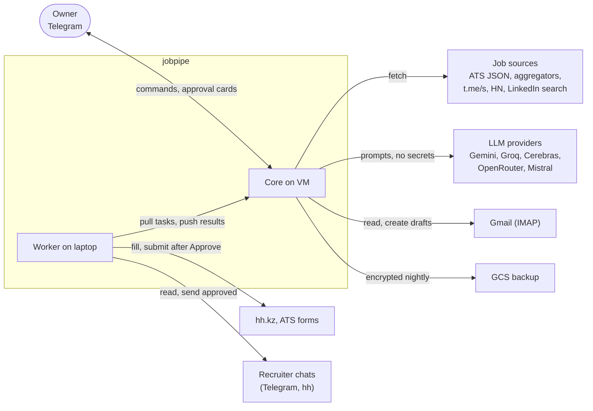
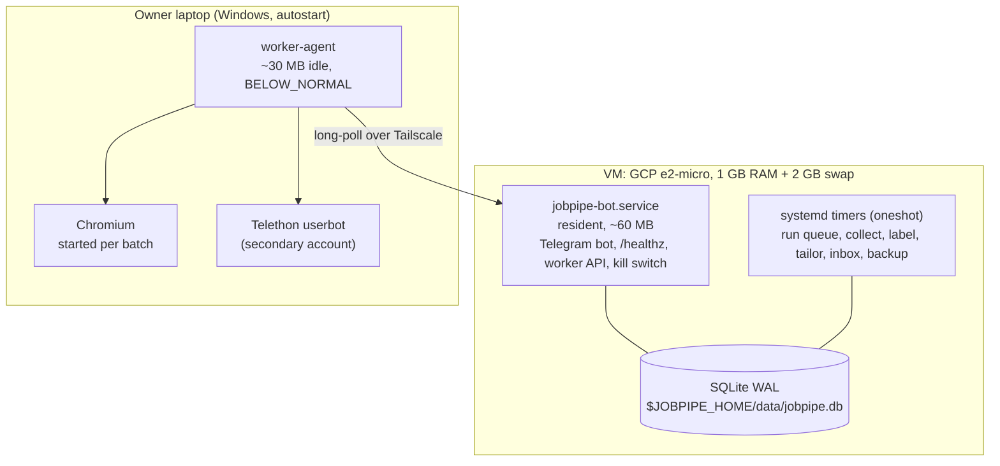
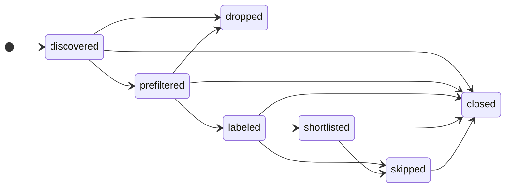
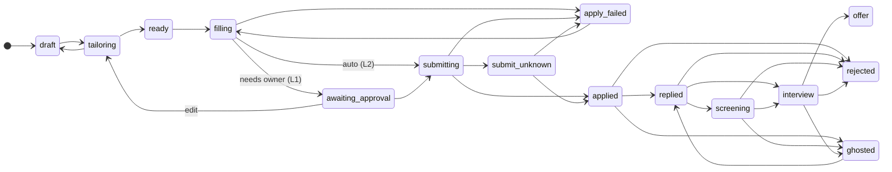
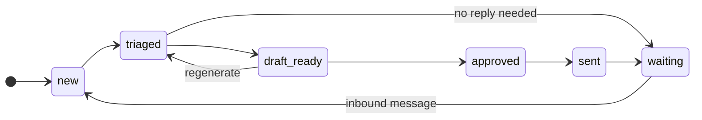

# jobpipe architecture

Status: accepted for S0 (2026-11-26). Changes to a boundary add an ADR in `docs/adr/`.

jobpipe runs one person's job search end to end: it collects vacancies, filters and labels them,
tailors a CV and cover letter from a fact base, applies through a browser, reads replies, drafts
answers and tracks the funnel. The owner drives it from one Telegram bot. Nothing leaves the
system on the owner's behalf without an explicit Approve, unless the owner raised that action to
autonomy level L2.

## 1. Context



## 2. Containers and process model



* **One resident process** (`jobpipe bot`) holds what must react instantly: the Telegram bot, the
  pause flag, `/healthz` and, from S4, the worker API. Everything else is a **oneshot** command
  started by a systemd timer: it runs, writes to SQLite, exits. Between runs it costs no memory.
  See [ADR 0001](adr/0001-process-model.md).
* **The browser worker and the userbot run on the owner's laptop**, which has a residential KZ IP
  and enough RAM for Chromium. The laptop is behind NAT, so the worker pulls tasks from the core.
  Where the browser runs is a config value, not a code change. See [ADR 0006](adr/0006-browser-worker-pull.md).
* **One Telegram bot** for everything: commands, approvals, alerts, worker status and, later, the
  approval Mini App (a Mini App is attached to the same bot). See [ADR 0013](adr/0013-single-telegram-bot.md).

## 3. Code layout (ports and adapters)

```
src/jobpipe/
  domain/      states (transition tables), models, errors. No I/O.
  ports/       Protocols: Clock, Notifier, LLMTransport, Source, Applier, Inbox, KnowledgeBase
  adapters/
    storage/   sqlite: connection, migrations, repositories
    llm/       openai_compat (Gemini, Groq, Cerebras, OpenRouter, Mistral); anthropic later
    notifier/  telegram (Bot API over httpx, used by oneshot jobs)
    sources/   one module per source (S1)
    appliers/  hh, greenhouse, lever, ashby (S4)
    inbox/     gmail_imap, hh_chat, telegram_userbot (S5)
  services/    state transitions + events, task queue, LLM router, control (pause/kill), pii
  workers/     queue runner and task handlers
  bot/         aiogram app, owner-only middleware, status rendering
  config/      pydantic settings loaded from YAML + secrets.env
  cli.py       `jobpipe ...` entry point
```

Rules: `domain` imports nothing from the project. `services` depend on `ports` and on the storage
repositories, never on a concrete external adapter. Adapters are chosen in one place (`cli.py` /
the bot's startup) from config.

## 4. Where data lives

The repository is public and holds only code, prompts and example config. Everything personal
lives in `JOBPIPE_HOME` (default `~/.jobpipe`, on the VM `/var/lib/jobpipe`):

```
$JOBPIPE_HOME/
  config/      settings.yaml, llm.yaml, policy.yaml, protected.yaml, companies.yaml, sources.yaml
  kb/          facts.yaml, answers.yaml, CV templates (S3)
  data/        jobpipe.db, backups/, artifacts/ (PDFs, screenshots)
  leakguard.txt  private strings that must never be committed (email, phone, ...)
```

Secrets are in `/etc/jobpipe/secrets.env` on the VM (mode 600, owner `jobpipe`) or
`$JOBPIPE_HOME/secrets.env` locally. They are never logged, committed or sent to an LLM.
See [ADR 0005](adr/0005-public-repo-private-home.md).

## 5. Data model (SQLite)

| table | purpose |
|---|---|
| `schema_migrations` | applied migration versions |
| `events` | append-only log of every state change and notable action; funnel metrics are computed from it |
| `jobs` | one row per vacancy: `state`, source, kind, company, title, url, location, country, posted_at, `fingerprint`, `drop_rule`, `duplicate_of`, `last_seen`, `digested_at`; description and signals in `data_json` |
| `source_runs` | one row per source per collect run: status, fetched, new, kept, dropped, closed, errors |
| `source_cursors` | per-source cursors (e.g. last Telegram post id per channel) |
| `applications` | one row per (job) application, `state`, unique `idempotency_key` |
| `conversations` | one row per thread with a recruiter, `state` |
| `tasks` | the queue: type, payload, status, attempts, `reclaims`, `next_run_at`, lease, unique `idempotency_key`, `last_error` |
| `side_effects` | key stored **before** any external action; status `planned → done / unknown / failed`; `notified_at` for unknown-outcome alerts |
| `control` | key/value switches: `paused`, `dry_run.<platform>` |
| `runs` | each oneshot run: command, pid, `proc_start` (pid-reuse guard), host, start/finish, status. Used by the kill switch |
| `llm_calls` | cost and usage ledger: provider, model, task, prompt version, tokens, latency, status |
| `llm_daily` | daily roll-up of `llm_calls` older than the retention window |
| `provider_state` | per-provider cooldown and circuit-breaker state |

Old rows are deleted or compacted to their resolution daily ([ADR 0018](adr/0018-retention.md)).

Migrations are numbered SQL files in `src/jobpipe/adapters/storage/migrations/`, applied in a
transaction at startup. Storage sits behind repositories so SQLite can later be swapped for
Postgres. See [ADR 0002](adr/0002-sqlite.md).

## 6. State machines

Every transition goes through `services.state.transition()`, which checks the transition table,
updates the row only if it is still in the expected state, and writes an `events` row in the same
transaction.



`protected` is a routing flag on a job, not a state: a protected job is labeled like any other,
then goes to the protected funnel and never gets an automatic application.



Any non-terminal application state can also go to `withdrawn`. `filling → submitting` is
auto-apply when every check passes ([ADR 0016](adr/0016-auto-apply.md)); otherwise
`filling → awaiting_approval → submitting` is the two-phase submit with the owner's Approve
([ADR 0007](adr/0007-two-phase-submit.md)).



### Attention tags

Every state (and every task and side-effect status) carries one tag, so `/status` and the Mini App
can show what needs the owner ([ADR 0017](adr/0017-attention-tags.md)):

| tag | meaning | states |
|---|---|---|
| `ok` | moving along | everything not listed below |
| `needs_human` | waiting for the owner | application: awaiting_approval, apply_failed, submit_unknown, replied, screening, interview, offer · conversation: draft_ready · protected job on the shortlist · dead task · unknown side effect |
| `not_ok` | ended badly or filtered out, already handled | job: dropped, skipped, closed · application: rejected, ghosted, withdrawn · failed side effect |

## 7. Task queue

`tasks` rows are leased with one atomic `UPDATE ... RETURNING`. A lease has an owner and an
expiry; an expired lease returns the task to `pending` and counts a reclaim, and a task that kills
its runner `max_reclaims` times is dead-lettered. Failures reschedule with exponential
backoff and equal jitter (`delay = d/2 + rand(0, d/2)`, `d = min(cap, base·2^(attempt-1))`).
After `max_attempts` the task becomes `dead` and the owner gets a Telegram alert. Enqueueing with
an existing `idempotency_key` returns the existing task instead of creating a second one.
See [ADR 0003](adr/0003-task-queue.md).

## 8. Kill switch

`/pause` sets `control.paused=1`, then sends SIGTERM to every process listed as running in `runs`
(skipping any pid whose recorded start time no longer matches: a reused pid) and SIGKILL to any
still alive after 8 s. The runner's SIGTERM handler only sets a flag; handlers stop at the next
`ctx.guard()`. Runners check the flag before every task and before any side effect; a timer
started while paused exits at once. External side effects first write a `side_effects` row as
`planned`; a run killed mid-action leaves it `planned`, and the next run marks it `unknown`,
alerts the owner until the alert is delivered, and never retries it. The owner settles it with
`jobpipe effects resolve KEY done|failed|reset`. See [ADR 0014](adr/0014-kill-switch.md).

## 9. LLM router

`services.llm_router.Router.complete(task, variables, schema=..., personal=...)`:

1. Load the prompt `prompts/<task>/<version>.md` (version from `llm.yaml`), fill variables.
2. If `personal`, replace configured personal values with placeholders (`{{NAME}}`, ...) when
   `pii_redaction: required`, and skip providers marked `trains_on_data` unless allowed.
3. Walk the task's provider chain. Skip a provider in cooldown, with an open circuit breaker, or
   without quota left (RPM/RPD/TPM/TPD counted from `llm_calls`).
4. Call it. 429 → cooldown until `retry-after`, next provider. 5xx/timeout → one retry with
   backoff, then next provider. N consecutive failures → breaker open for X minutes.
5. Validate structured output with pydantic; one repair attempt, then the next provider; when the
   chain is exhausted raise `LLMUnavailable` (the queue then retries or dead-letters).
6. Restore placeholders and record the call in `llm_calls` with the prompt version.

See [ADR 0004](adr/0004-llm-router.md).

## 10. Scheduling (Asia/Almaty)

| command | timer | where |
|---|---|---|
| `run queue` | every minute | VM |
| `run collect` | 08, 11, 14, 17, 20, 23 | VM |
| `run label` | 07:00 + on demand (S2) | VM |
| `run digest` | 09:00 | VM |
| `run tailor` | after label (S3) | VM |
| apply phases | weekdays 10–19 with jitter (S4) | laptop |
| `run inbox` | every 15 min, 08–23 (S5) | VM + laptop |
| `backup` | 03:00 | VM |
| `run retention` | 04:00 | VM |

Timers use `OnCalendar=` with `Asia/Almaty`; schedules live in `ops/systemd/` and are generated
from config from S1 on.

## 11. Safety rules in code

* Truth gate: CVs are assembled from fact ids; free text is validated claim by claim (S3, ADR 0008).
* Autonomy per action in `policy.yaml`. Applications default to L2: submitted automatically when
  every check passes (not protected, all questions answered from the KB, truth gate passed, no
  similar application, dry run off, daily cap left), otherwise an approval card
  ([ADR 0016](adr/0016-auto-apply.md)). Messages default to L1; L2 only after 20 clean approvals
  and never for sensitive topics.
* Idempotency: one application per (company, vacancy) forever; cooldowns only where configured;
  similar roles at the same company produce a warning ([ADR 0009](adr/0009-idempotency.md)).
* `DRY_RUN` defaults to true per platform; flipping it is an explicit command.
* Captcha, 2FA or a security check pauses the task and asks the owner to solve it in the visible
  worker window; no solvers, proxy rotation or fingerprint changes ([ADR 0012](adr/0012-captcha-human.md)).
* Logs are JSON lines to journald; emails and phone numbers of third parties and every secret value
  are masked by a logging filter ([ADR 0015](adr/0015-logging.md)).

## 12. ADR index

| # | decision |
|---|---|
| [0001](adr/0001-process-model.md) | one resident bot + oneshot jobs on systemd timers |
| [0002](adr/0002-sqlite.md) | SQLite in WAL mode with numbered SQL migrations behind repositories |
| [0003](adr/0003-task-queue.md) | task queue in SQLite: leases, backoff with jitter, dead-letter, idempotency keys |
| [0004](adr/0004-llm-router.md) | LLM router with per-task provider chains, quotas, cooldowns, breaker |
| [0005](adr/0005-public-repo-private-home.md) | public repo, private data in JOBPIPE_HOME, leak guard |
| [0006](adr/0006-browser-worker-pull.md) | browser worker and userbot on the laptop, pulling tasks |
| [0007](adr/0007-two-phase-submit.md) | two-phase submit with a fill manifest; `submit_unknown` |
| [0008](adr/0008-tailoring-as-selection.md) | tailoring selects facts; pseudonymize PII before LLM calls |
| [0009](adr/0009-idempotency.md) | one application per vacancy; cooldowns optional per company |
| [0010](adr/0010-gmail-imap.md) | Gmail over IMAP with an app password; drafts via APPEND |
| [0011](adr/0011-linkedin-discovery-only.md) | LinkedIn for discovery only; apply on the company ATS |
| [0012](adr/0012-captcha-human.md) | captcha and security checks are solved by the owner |
| [0013](adr/0013-single-telegram-bot.md) | one Telegram bot for control, approvals, worker status, Mini App |
| [0014](adr/0014-kill-switch.md) | kill switch: DB flag + SIGTERM/SIGKILL of recorded runs |
| [0015](adr/0015-logging.md) | JSON logs to journald with a redaction filter |
| [0016](adr/0016-auto-apply.md) | applications auto-submitted when every check passes; cards are the fallback |
| [0017](adr/0017-attention-tags.md) | attention tags on states: ok / needs_human / not_ok |
| [0018](adr/0018-retention.md) | daily retention: delete old detail, keep resolutions |
| [0019](adr/0019-collection.md) | collection: sources, polite HTTP, prefilter, dedupe, closures, digest |
